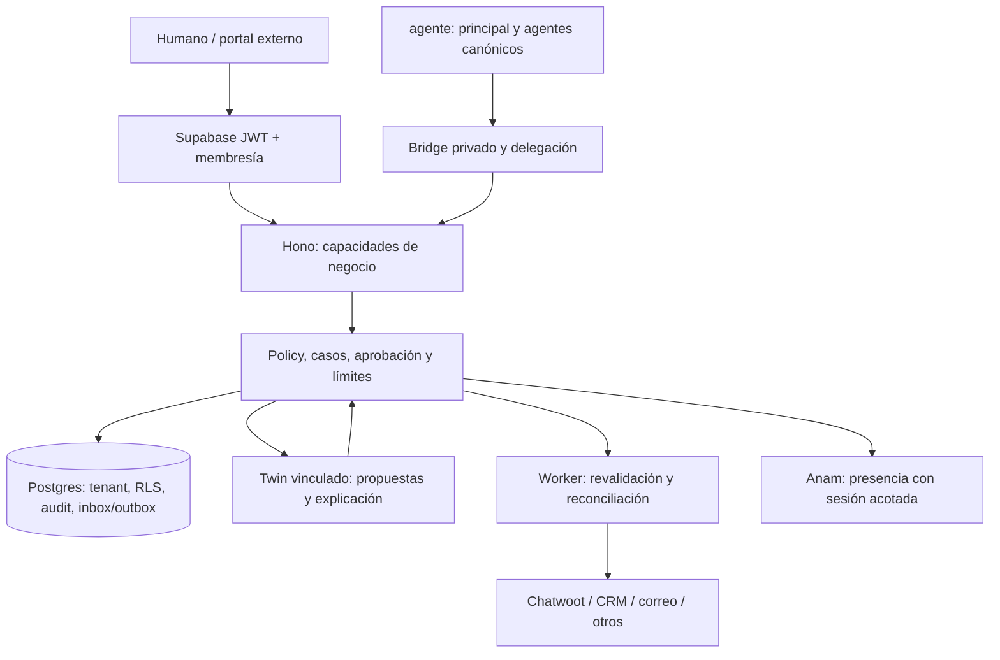

# Arquitectura y autoridad

Propuesta TypeScript con Hono/pnpm, contratos runtime Zod/JSON Schema, core de policy/FSM, Postgres/Supabase, workers con leases y adaptadores backend. No se integra el servidor entero del padre como dependencia ni se introduce un scheduler empresarial alternativo. Los plazos de SLA y reintentos técnicos son del servicio; la rota empresarial y agentes canónicos son del padre.

## Cuatro niveles que no se mezclan

1. Organización operadora: presta el SaaS y emplea agentes canónicos en el padre.
2. Tenant de cliente del SaaS: frontera de seguridad, contrato, membresías, datos y presupuesto.
3. CustomerOrganization/Contact dentro de ese tenant: empresas y personas a las que el cliente atiende. No son tenants automáticamente.
4. Principal humano/agente: quién solicita o ejecuta y con qué capacidad. Un contacto identificado por email no se convierte automáticamente en usuario autorizado.

Un usuario puede pertenecer a varios tenants; debe seleccionar uno y el servidor contrastarlo. Un agente de la operadora actúa sobre un tenant cliente mediante delegación explícita; conservar origen y objetivo separados. Un representante de una CustomerOrganization tiene ACL de los recursos compartidos con él, aunque tenga una sesión Supabase válida. Los datos públicos de un help center requieren un flujo de publicación separado de la KB privada.

## Autoridad por dominio

| Dominio | Autoridad |
|---|---|
| Identidad canónica/organización agéntica | agente; el servicio mantiene TwinBinding y mandatos |
| Identidad de acceso humano | Supabase y directorio/membresías verificados |
| Contactos/empresas/propiedades | Campo a campo en AuthorityMap: middleware o CRM elegido |
| Consentimiento/preferencias y pruebas | Ledger local con fuente; sincronización no amplía permisos |
| Caso y reloj SLA | Middleware o helpdesk elegido por WorkOrder; un único motor activo |
| Entrega de un mensaje | Proveedor/canal; el middleware custodia intención, aprobación y receipts |
| Facturación/cobro/contrato financiero | Puerto autorizado del dominio correspondiente; este servicio propone |
| Rota y tareas organizativas | Padre; el servicio emite hechos y ejecuta trabajo delegado |

Las funciones pueden solaparse con ventas, marketing, redes y otros servicios. Cada ServiceAgreement y WorkOrder decide actor, datos compartidos y quién responde por el efecto. El grafo de repos es conceptual, no prueba de que existan todos los servicios. Un cliente externo opera desde el portal propio sin tener que usar AgntiaPro; el equipo especialista sigue enlazado al registro canónico.

Persistir tenantId en entidades, relaciones, jobs, blobs, métricas y claves de idempotencia. Las transacciones locales incluyen estado/audit/outbox; no abarcan HTTP remoto. Una cola no es fuente final de verdad. Exportaciones, resync y reindexación conservan snapshots/versiones y no vuelven a enviar efectos. Registrar freshness para diferenciar dato actual, ausente, conflictivo y obsoleto.
